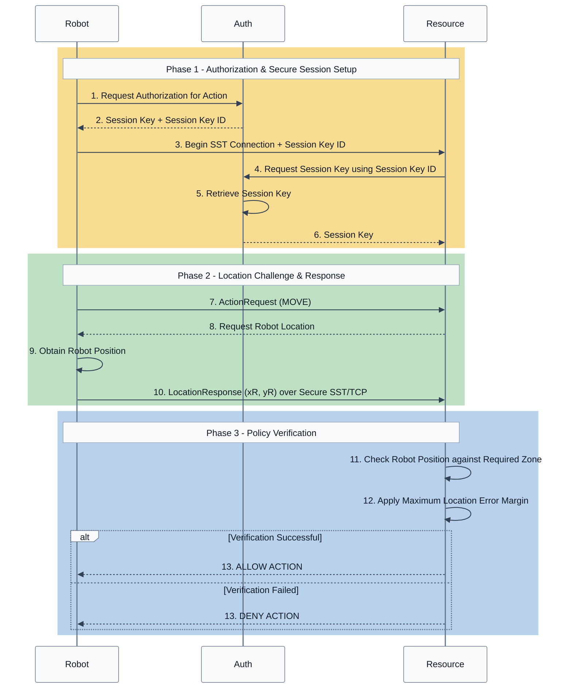

# SST UWB Location Verification

This example extends SST authorization with physical location verification using ultra-wideband (UWB) ranging. A Resource can require a Robot to satisfy a physical-location policy before authorizing an action.

The prototype combines SST secure communication, JSON-based verification policies, UWB ranging, and least-squares multilateration with live UWB ranging implementation currently in progress.

---

## System Overview

The system consists of three primary entities:

- **Robot:** Requests an action and provides its physical position.

- **Resource:** Enforces the authorization and location policy.

- **Auth:** Provides SST session credentials. Future work will also associate verification policies with authorization information supplied by Auth.

UWB anchors provide ranging measurements used to estimate the Robot's physical position.

### Implementation Files

| Component | File |

|---|---|

| Robot / Prover | `prover.c` |

| Resource / Robot Arm | `robot_arm.c` |

| Protocol messages and helpers | `protocol.h`, `protocol.c` |

| Location policy verification | `location_verifier.h`, `location_verifier.c` |

| Verification policy parsing | `verification_policy.h`, `verification_policy.c` |

| Verification policy configuration | `verification_policy.json` |

| Multilateration | `multilateration.h`, `multilateration.c` |

| Multilateration test | `multilateration_test.c` |

| Robot SST configuration | `prover.config` |

| Resource SST configuration | `robot_arm.config` |

| Build configuration | `CMakeLists.txt` |

---

## Authorization Protocol

The current prototype extends the SST connection with a location challenge-response protocol.

1. The Robot requests authorization for an action from Auth.

2. Auth provides the Robot with a session key and session key ID.

3. The Robot begins an SST connection with the Resource using the session key ID.

4. The Resource requests the corresponding session key from Auth.

5. Auth retrieves the session key.

6. Auth provides the session key to the Resource.

7. The Robot sends an ActionRequest requesting the MOVE action.

8. The Resource sends a location request to the Robot.

9. The Robot obtains its current position.

10. The Robot sends a LocationResponse containing (xR, yR) to the Resource over the secure SST/TCP connection.

11. The Resource checks the Robot's position against the required zone in the verification policy.

12. The Resource applies the configured maximum location error margin.

13. The Resource returns an ActionResponse allowing or denying the requested action.



**Files:** `protocol.h`, `protocol.c`, `prover.c`, `robot_arm.c`

The protocol uses explicit message types and fixed-width fields for messages exchanged between the Robot and Resource. `read_exact_message()` provides common validation for received secure messages.

---

## Verification Policy

Physical verification requirements are represented using a JSON policy.

The policy specifies:

- Verification type

- Verification method

- UWB ranging method

- UWB anchor IDs

- UWB anchor coordinates

- Required physical zone

- Maximum permitted location error

**Files:** `verification_policy.json`, `verification_policy.h`, `verification_policy.c`

The parser currently accepts the supported location policy configuration:

```text

type           = location

method         = uwb

ranging_method = ds_twr

```

Invalid zone bounds, negative error margins, unsupported policy types, and invalid anchor configurations are rejected during policy parsing.

The current prototype loads the policy locally on the Resource. Future work will associate the verification policy with authorization information supplied by Auth.

### Location Decision

**Files:** `location_verifier.h`, `location_verifier.c`

The Resource evaluates the reported position against the authorized zone.

`max_error_m` is applied conservatively by shrinking each boundary of the authorized zone by the configured error margin. This prevents a position near a boundary from being authorized when measurement uncertainty could place the Robot outside the permitted region.

For example, with:

```text

x = [0.0, 1.0]

y = [0.0, 1.0]

max_error_m = 0.25

```

the effective authorized region is:

```text

x = [0.25, 0.75]

y = [0.25, 0.75]

```

---

## UWB Localization

The localization system uses Qorvo DWM3001CDK devices and DS-TWR ranging.

```text

                         UWB Tag

                            |

          +-----------------+-----------------+

          |                 |                 |

          v                 v                 v                 v

      Anchor 1          Anchor 2          Anchor 3          Anchor 4

      distance          distance          distance          distance

          |                 |                 |                 |

          +-----------------+--------+--------+-----------------+

                                   |

                                   v

                           Multilateration

                                   |

                                   v

                                 (x,y)

```

**Files:** `multilateration.h`, `multilateration.c`

Four anchors provide an overdetermined 2D localization system. The implementation uses least-squares multilateration to estimate the position that best fits the measured UWB ranges.

The solver rejects invalid or negative ranges, non-finite values, and degenerate anchor geometry.

---

## Building

### Dependencies

The example requires:

- CMake 3.19 or later

- SST C API dependencies

- pthreads

- cJSON

- pkg-config

On Debian/Raspberry Pi OS:

```bash

sudo apt update

sudo apt install libcjson-dev pkg-config

```

### Configure and Build

From the SST C API directory:

```bash

cd examples/location_proof_example

mkdir -p build

cd build

cmake ..

make -j4

```

The build produces:

```text

prover

robot_arm

multilateration_test

```

---

## Testing Multilateration

**File:** `multilateration_test.c`

From the `build` directory:

```bash

./multilateration_test

```

The synthetic test uses four anchors surrounding a tag at `(1,1)`:

```text

A3 (0,2) ---------------- A4 (2,2)

    |                         |

    |          Tag            |

    |         (1,1)           |

    |                         |

A1 (0,0) ---------------- A2 (2,0)

```

Expected output:

```text

Estimated position:  (1.000, 1.000) m

Expected position:   (1.000, 1.000) m

Error:               (0.000000, 0.000000) m

Multilateration test passed.

```

---

## Running

Before running the example, generate the SST example credentials:

```bash

cd "$SST_ROOT/examples"

./generateAll.sh

```

Build Auth if it has not already been built.

### 1. Start Auth

```bash

cd "$SST_ROOT/auth/auth-server"

java -jar target/auth-server-jar-with-dependencies.jar \

    -p ../properties/exampleAuth101.properties

```

### 2. Start the Resource

In another terminal:

```bash

cd "$SST_ROOT/entity/c/examples/location_proof_example/build"

./robot_arm ../robot_arm.config ../verification_policy.json

```

The Resource loads and validates the verification policy before accepting a Robot connection.

### 3. Start the Robot

In a third terminal:

```bash

cd "$SST_ROOT/entity/c/examples/location_proof_example/build"

```

The Robot accepts optional `x` and `y` coordinates for testing. If no coordinates are supplied, the prototype uses its default position.

### ALLOW Case

```bash

./prover ../prover.config 0.5 0.5

```

Expected Robot output includes:

```text

[PROVER] Current position: (0.50, 0.50)

[PROVER] ACTION ALLOWED

```

Expected Resource output includes:

```text

[RESOURCE] Robot claims position: (0.50, 0.50)

[RESOURCE] Movement allowed

```

### DENY Case

Restart `robot_arm`:

```bash

./robot_arm ../robot_arm.config ../verification_policy.json

```

Then run:

```bash

./prover ../prover.config 1.5 0.5

```

Expected Robot output includes:

```text

[PROVER] Current position: (1.50, 0.50)

[PROVER] ACTION DENIED

```

Expected Resource output includes:

```text

[RESOURCE] Robot claims position: (1.50, 0.50)

[RESOURCE] Movement denied

```

---

## Current Implementation Status

### Completed

- [x] SST action and location challenge-response protocol

- [x] Explicit protocol message types

- [x] Shared secure-message receive validation

- [x] JSON verification-policy parsing and validation

- [x] Policy-based location authorization

- [x] Maximum-error-aware authorization boundaries

- [x] Four-anchor UWB DS-TWR ranging

- [x] Four-anchor least-squares multilateration

- [x] Synthetic multilateration test

- [x] Reproducible ALLOW and DENY cases

### In Progress

- [ ] Integrate live UWB ranging data over serial into the Robot

- [ ] Connect live UWB measurements to multilateration and SST

- [ ] Replace the prototype Robot position with its measured UWB position

### Future Work

- [ ] Implement independent Resource-side UWB location verification

- [ ] Compare the Robot-reported position with the independently verified position

- [ ] Deliver verification policies through Auth

- [ ] Convert the Resource into a persistent authorization service

- [ ] Perform end-to-end accuracy and latency evaluation

- [ ] Complete deployment and technical documentation